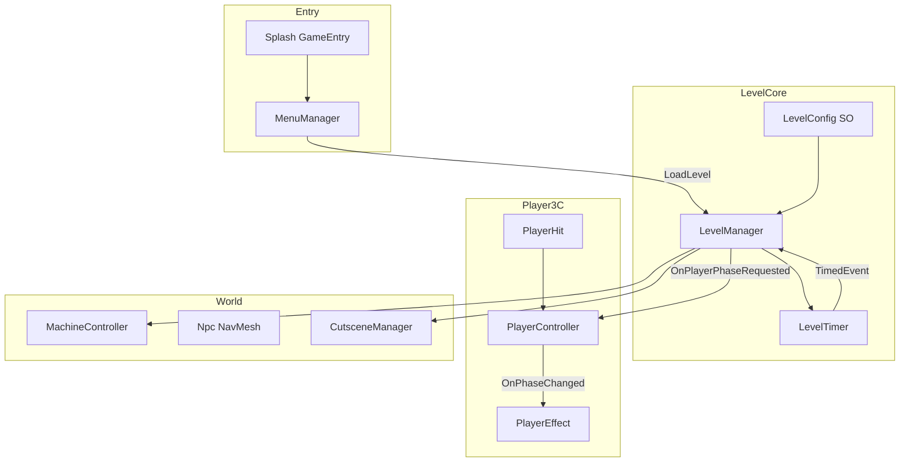
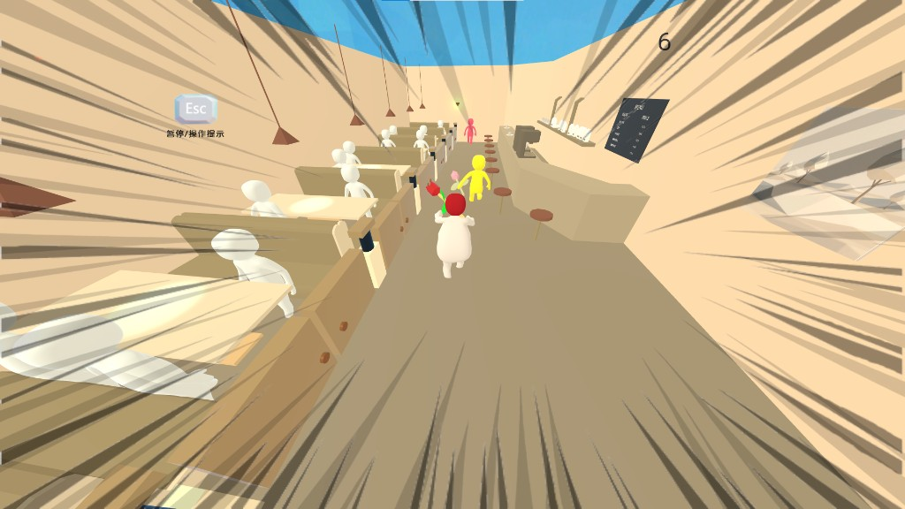

# EMERGENCY -ING

**仓库名：** [Emergency-Revision](https://github.com/linkbgame/Emergency-Revision)

基于 APR Active Ragdoll 的 **3D 物理动作关卡**：用 `LevelConfig` + 定时事件驱动危机相位（着火）、受击与机关，面向 **ChinaJoy 等线下展示** 与 3C 手感迭代。

<p align="center">
  
</p>

## 项目背景

这是我在 **学习 Unity 的较早阶段** 参与的合作项目：2025 年 7 月中旬起，约一个月线下开发。当时先参考 [APR 相关教程](https://www.bilibili.com/video/BV1ur4y1w719) 把布娃娃跑起来，再在 ChinaJoy 前补上着火、击飞并打磨 3C，完成出展。

以今天的工程标准衡量，**架构与项目管理都不够成熟**——`Character.cs` 与 `PlayerController` 双轨并存、部分关卡未进 Build Settings、注释与 TODO 仍可见。我选择在 README 里 **如实说明**，而不是事后包装成从零就是最佳实践。**回过头看，这段试错仍然不可或缺**：第一次把物理手感、内容导演和 deadline 绑在一起交付。

实机演示：[B 站 BV1versBhEiY](https://www.bilibili.com/video/BV1versBhEiY)

## 技术栈


| 类别 | 实际使用 |
|------|----------|
| 引擎 / 语言 | Unity **2022.3.62f3c1**，C# |
| 渲染 | **内置管线（Built-in）**，`GraphicsSettings` 未指定 URP/HDRP |
| 输入 | Legacy Input Manager（`Vertical` / `Horizontal` / `Jump` / `Fire1` / `Fire2`），未使用 Input System Package |
| 关卡导演 | Timeline（`CutsceneManager`）、UGUI + TextMeshPro |
| 寻路 | `com.unity.ai.navigation` + `Npc` 上的 `NavMeshAgent` |
| 布娃娃底座 | `Assets/APR Player`（资源导入，**不是** UPM 包） |
| 开发辅助 | `com.boxqkrtm.ide.cursor`、`com.coplaydev.unity-mcp`（编辑器侧，不参与运行时玩法） |

## 核心特性

1. **自研 `PlayerController` Active Ragdoll 控制**  
   在 APR 的 `ConfigurableJoint` + `JointDrive` 思路上扩展奔跑、FOV、相位与击飞。`Awake` 阶段把部件写入 `APR_Parts` / `APR_Joints` / `APR_Rbs`，避免 Update 里反复 `GetComponent`。

2. **玩家相位与表现解耦**  
   `PlayerController.PlayerPhase`：`Normal` → `HeadTurningRed` → `HeadOnFire` → `HeadBoom`。`LevelManager.OnPlayerPhaseRequested` 驱动逻辑，`PlayerEffect` 订阅 `OnPhaseChanged` 做变色、粒子与速度线。

3. **数据驱动关卡**  
   `LevelConfig` ScriptableObject 配置倒计时、着火时长、`TimedEventData[]`（`FromStart` / `FromEnd`，类型含 `ChangePlayerPhase`、`ActivateMachine`、`PlayCutscene` 等）。示例：`Assets/Configs/LevelConfig/Level_01.asset`。

4. **关卡生命周期单例**  
   `LevelManager` 协程异步加载、`DontDestroyOnLoad`；暂停时 `Time.timeScale = 0` 并关掉 `PlayerController` 输入。`LevelTimer` 用 `Time.unscaledDeltaTime` 倒计时，暂停菜单下时间仍准确。

5. **可扩展场景初始化**  
   `ILevelInitializable` + `PerObjectConfigSO` + `LevelContext`：按 `objectId` 匹配配置，`Initialize` 可返回 `IEnumerator` 做异步初始化。

6. **3C 组件化**  
   `PlayerHand` / `PlayerFeet` / `PlayerHit` 挂在同一预制体上，Inspector `[SerializeField]` 绑定。抓取条件写死为标签 `CanBeGrabbed` + `FixedJoint`。

7. **Npc 子系统**  
   `Npc` 复用 APR 驱动 + `NavMeshAgent`；`NpcHit` 按 Layer 处理摔倒 / 击飞，并带「霸体击飞」开关 `useBTHitFly`（注释标明仍有待深化）。

8. **编辑器调试面板**  
   `LevelManagerEditor`：Play Mode 下一键开停计时、触发下一条 TimedEvent、强制胜负。`LevelConfigEditor`：编辑器内按 `sceneName` 加载对应场景。

## 架构设计

```
Assets/
├── Scripts/3C/          # PlayerController、相机、手/脚/受击/特效
├── Scripts/Level/       # LevelManager、Timer、Config、机关、过场、音频
├── Scripts/Npc/         # Npc / NpcHit / NpcGenerator
├── Scripts/UI/          # HUD、PauseMenu、ResultUI、LoadingUI
├── Scripts/Character.cs # 早期 APR 模板级主控（遗留，非当前主路径）
├── Editor/              # LevelManagerEditor、LevelConfigEditor
├── Configs/             # LevelConfig、Timeline
├── Scenes/              # Splash、Menu、Level_1 … Level_8
├── Prefabs/             # 玩家、Npc、UI
├── Resourses/           # 实际资源目录（拼写如此，不是 Resources）
└── APR Player/          # 第三方 Active Ragdoll 插件
```



### 关键设计决策

**1. ScriptableObject + TimedEvent，而不是每关写死脚本**  
`LevelConfig` 让策划/展演示改时间轴不必改代码。代价是运行时强依赖 Inspector 配置正确：`sceneName` 必须出现在 Build Settings，Layer / Tag 名必须对上。

**2. C# `event Action` 观察者，而不是全局 EventBus**  
`LevelManager`、`PlayerController`、`LevelTimer`、`PauseMenu` / `ResultUI` 用显式订阅，并在 `OnDestroy` 解绑。跨系统爆炸伤害仍是 `PlayerEffect` 里的 TODO，仓库里 **没有** 通用事件总线。

**3. 物理 Active Ragdoll，而不是纯动画人**  
`ConfigurableJoint` 把刚体「拉」回目标姿态，手感由 `balanceHeight`、`StepDuration`、`moveResponse`、关节刚度决定。CPU 物理成本更高，所以部件引用必须在初始化时缓存。

### 设计模式对照（只写代码里有的）

| 模式 | 出现位置 | 用途 |
|------|----------|------|
| 轻量状态（枚举 + 事件） | `PlayerController.PlayerPhase`、`OnPhaseChanged` | 危机节奏，不是独立 StateMachine 类 |
| 观察者 | `event Action`（LevelManager / Timer / UI） | 模块解耦 |
| 单例 | `LevelManager`、`AudioManager` | 跨场景常驻 |
| 数据驱动 | `LevelConfig`、`TimedEventData`、`PerObjectConfigSO` | 关卡配置 |
| 对象池（音频） | `AudioManager.oneShotPool` | SFX one-shot，避免频繁创建 `AudioSource` |

没有独立状态机框架，也没有玩法实体对象池。

## 演示

**实机演示：** [https://www.bilibili.com/video/BV1versBhEiY](https://www.bilibili.com/video/BV1versBhEiY)



*餐厅主题关卡实机：第三人称跟随、右上角 HUD 倒计时、左上角 Esc 暂停提示；径向速度线与奔跑 / 危机阶段表现相关（`PlayerEffect.speedLines`、`HUD`、`LevelTimer`）。*

<!-- 可选：补充 GIF — 抓取 CanBeGrabbed、Npc 被击飞、HeadTurningRed 变色 -->
<!-- 可选：ChinaJoy 现场照片 -->

技术参考（非本作宣传片）：开发阶段使用的 [APR 教程 BV1ur4y1w719](https://www.bilibili.com/video/BV1ur4y1w719)。

## 运行方式

1. 克隆仓库  
   `git clone https://github.com/linkbgame/Emergency-Revision.git`
2. 用 Unity Hub 安装 **2022.3.62f3c1**（同系列 2022.3 LTS 可能能打开，但可能触发升级/降级）。
3. 用 Hub **Add** 项目根目录，等待 Package 解析与首次导入（`Library/` 由编辑器生成，已被 `.gitignore` 忽略）。
4. 打开 **`Assets/Scenes/Splash.unity`** 或 **`Assets/Scenes/Menu.unity`**，点击 Play。  
   `GameEntry` 在 Splash 淡入后左键进入 Menu；Menu 通过 `MenuManager.LoadLevelDirect(LevelConfig)` 加载关卡。场景中需要已有常驻 `LevelManager`。
5. **Build Settings 现状（重要）**：当前只启用了 `Splash`、`Menu`、`Level_1_date`。仓库里还有 `Level_2_class` … `Level_8_Corssing the_road` 等场景文件，**未加入 Build** 时 `LoadSceneAsync(config.sceneName)` 会失败。
6. 输入：WASD / 方向键移动，空格跳跃，鼠标左右键对应 `Fire1` / `Fire2` 伸手抓取，Esc 暂停。
7. 标签与层级（见 `Assets/ReadMe.txt`）：  
   - Tag：`CanBeGrabbed`  
   - Layer：`Player`、`Ground`；受击约定为 `HitFallDown` / `HitFly`（需在项目 Layers 中自行对齐场景碰撞体）
8. 玩家预制体实际路径：**`Assets/Resourses/Binder/Player`**（目录名拼写为 `Resourses`，不是 `Resources`）。

## 性能优化 / 踩坑记录

下列许多坑来自早期边做边学、规范滞后的阶段；后期部分已修，部分留作改进项。

### 做过的优化

- **缓存物理组件**：`PlayerController` 在初始化时填充 `APR_Joints` / `APR_Rbs`，注释明确禁止在 Update 里 `GetComponent`。
- **暂停与计时分离**：游戏暂停用 `timeScale = 0`，倒计时走 `unscaledDeltaTime`，避免暂停菜单把关卡时钟一起冻死。
- **事件解绑**：`LevelManager` 用显式 handler 订阅 UI，在 `OnDestroy` 解除，避免跨场景泄漏。
- **SFX 小池**：`AudioManager` 预创建 `oneShotPoolSize`（默认 8）个 `AudioSource` 做 one-shot。

### 踩过的坑

- **编码混用**：自研脚本一度是 GB18030，APR 脚本是 UTF-8，Cursor / Git 里中文乱码。已统一为 UTF-8 无 BOM，并用 `.editorconfig` / `.gitattributes` 约束。
- **Active Ragdoll 手感极敏感**：`balanceHeight`、关节刚度差几个单位就会「飘」或「钉死」，这是老师反馈「操作手感要优化」的技术根因。
- **`FindObjectsOfType` 用在关卡 Init**：一次性成本可接受，不能挪进每帧。
- **Build Settings ≠ 磁盘上的场景**：`LevelConfig.sceneName` 对不上已启用场景就会异步加载失败。
- **目录拼写**：`Resourses` 与文档里的 `Resources` 不一致，找预制体容易绕路。
- **协作习惯**：双轨脚本、Layer 未完全写进 `TagManager`、TODO 散落——若重来会先冻 scope、先约定 Build / Layer / 编码。

## 未来计划

这些是代码里标明未完成或仍属遗留的部分，**不是已实现功能**：

- `PlayerEffect` 爆炸后的范围伤害 / 摄像机切换（注释中的 EventBus 占位）
- `LoadingUI` 的 UI 元素绑定（`TODO: set UI elements`）
- 击飞与 Npc 霸体反制玩法深化（`PlayerController` / `Npc` 注释写「有待开发」）
- 清理 `Character.cs` 与 `PlayerController` 双轨
- 把 `Level_2` … `Level_8` 补进 Build Settings
- `MenuManager` 中被注释掉的 Loading / 单例绑定

## 许可证

未单独声明第三方 APR Player 的授权条款。复用本仓库前请自行确认 `Assets/APR Player` 的资源许可。
